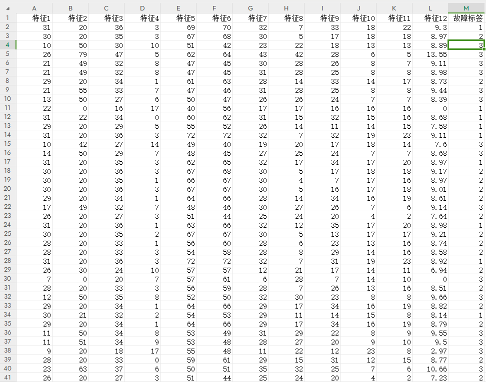
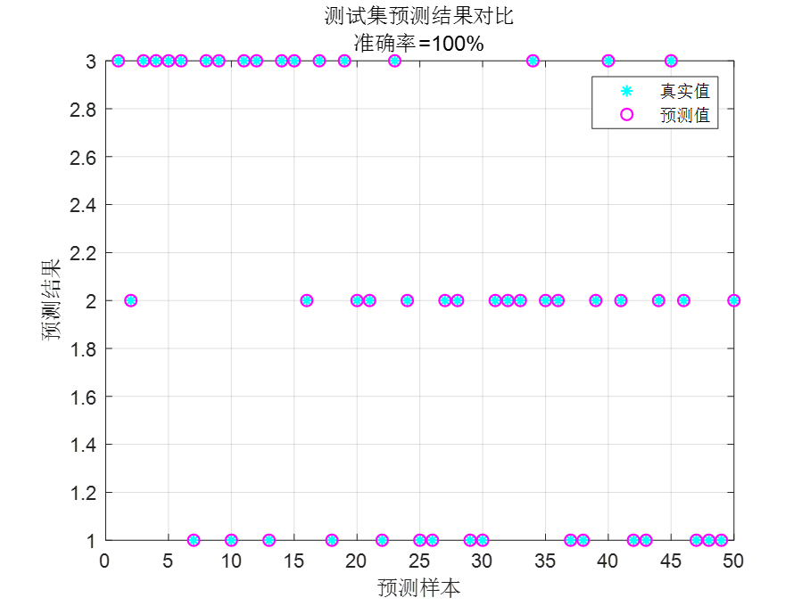
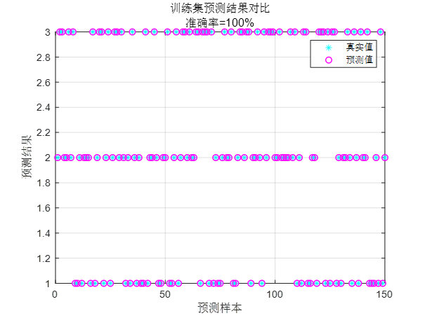

# CNN-SVM Convolutional Neural Network combined with Support Vector Machine for data classification prediction, fault identification algorithm, MATLAB program.

CNN-SVM Convolutional Neural Network combined with Support Vector Machine for data classification prediction, fault identification algorithm, MATLAB program.
Requirements: Version 2020 and above. Single variable feature input, as shown in the following Excel:
\n        \n      Comparison of predicted values vs actual values in the test set:
\n        \n      Comparison of predicted values vs actual values in the training set:
\n        \n
Applicable to bearing fault identification/diagnosis/classification, transformer oil gas fault identification/diagnosis/classification, power system transmission line fault area identification/diagnosis/classification, insulator, distribution network fault identification/diagnosis/classification.
EXCEL table can be directly imported, and the data in the Excel table can be changed accordingly.

## Images

<!-- PAYMENT_BLOCK -->

## Get this dataset

- Payment link (Stripe): [Buy now](https://buy.stripe.com/3cs8yP7sY87d0vu9AB)
- Payment QR code: 

<!-- /PAYMENT_BLOCK -->
